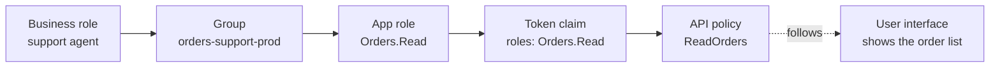

# Access management

This repository decides who has which app role. That is the technical end of a longer chain, which
starts with what someone does for a living. This page is about the whole chain, and the habits that
keep it honest.

## The chain

| Link                    | Lives in                                       | Changed by                         |
| ----------------------- | ---------------------------------------------- | ---------------------------------- |
| business role → group   | your identity governance, or group owners      | a manager, an access request       |
| group → app role        | `environments/<name>.json` (`roleMembers`)     | a pull request                     |
| app role → token claim  | Entra ID, at sign-in                           | nobody; automatic                  |
| token claim → policy    | the API's code ([Securing your API](securing-your-api.md)) | a pull request          |
| policy → user interface | the front end                                  | a pull request                     |

Keep the links one-directional. The user interface follows the API, the API follows the token, and
the token follows the assignments. A screen that decides on its own who may see something is a
second source of truth that will drift from the first.

## Design the roles

- **Roles describe tasks, not people or teams**: `Orders.Read`, `Orders.Admin`, not `SupportTeam`.
  Teams reorganise; tasks stay.
- **Roles accumulate.** A user with two roles has both. Do not make one role mean "not the other";
  make an administrator role imply reading in the API's policies, as the sample does.
- **Few roles.** Every role is a column in every review. Start with read, write or administer, and
  split only when someone needs part of a role and must not have the rest.
- **User roles and application roles apart.** A role an application gets (`Orders.Process`) should
  not also be given to people. `allowedMemberTypes` enforces it, and so do the policies.

## Groups, per environment

Assign groups, not people. Then joining a team is a group change, and no pull request at all.

Use a group per role *and* per environment: `orders-support-prod`, `orders-support-test`. A single
group for all environments gives production access to everyone who needs test access, which is
usually more people.

The limits of group assignment, worth knowing before you design around them:

- **No nested groups.** Only direct members of an assigned group get the role. See
  [Pitfalls](pitfalls.md#nested-groups-do-not-get-roles).
- **No groups for applications.** A managed identity in a group does not get the group's roles in
  its tokens. The script assigns service principals in listed groups directly.
- **Licensing.** Group assignment needs Microsoft Entra ID P1 or P2.

## The role matrix as code

The environment files are the matrix: who has what, where. Review it as code.

- **Access requests are pull requests.** The requester opens one; the owner of the application
  approves it. The history shows who asked, who approved, and when.
- **Required reviewers** on `app-registrations/environments/`, per environment if needed: the team
  that owns production access approves changes to `prod.json`.
- **Removing is as easy as adding.** Removing a name from the file removes the assignment on the next
  run. Leavers lose access by a one-line change, or automatically when they leave the group.

## Privileged and temporary access

A role that can do damage, such as administering production, should not be held permanently. Two
options:

- **Privileged Identity Management (PIM) for groups.** Make people *eligible* members of the group.
  They activate the membership when they need it, with a reason, for a few hours, after approval if
  you want. The group stays in the file; who is active changes by the hour, outside it.
- **A temporary pull request.** Add someone for an incident, remove them afterwards. Simpler, but
  relies on someone remembering to remove them.

Prefer PIM for anything in production that writes. Keep the file for standing access.

## Review periodically

Even with everything in code, access goes stale: a group keeps members who changed jobs, a service
principal outlives its service. Once a quarter, or as often as your audits ask:

1. List the effective members of every role per environment, groups expanded.
2. Let the owner of each application confirm or remove them.
3. Remove what nobody confirms.

Entra ID *access reviews* can automate this for groups. The file shows who *should* have access;
the review checks whether that is still true.

## Managed identity or app registration?

Both give an application an identity. Choose by where it runs, and what it calls:

| Situation                                              | Use                                          |
| ------------------------------------------------------ | -------------------------------------------- |
| Runs in Azure, calls Azure services or app-only APIs   | managed identity                             |
| Offers an API, with roles or scopes                    | app registration (this repository)           |
| Users sign in to it                                    | app registration                             |
| Calls another API on behalf of a user                  | app registration, with a certificate or a federated managed identity |
| Runs outside Azure                                     | app registration with a certificate, or workload identity federation |

An application object and a service principal are two different things. The *application* is the
definition, with roles, scopes and credentials. The *service principal* is its presence in a
tenant: role assignments, consent, sign-in. Role members are assigned to service principals; roles
are defined on applications. A managed identity has only a service principal; you cannot give it roles
of its own, only assign it roles of other applications.
