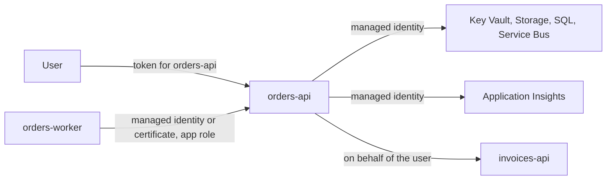
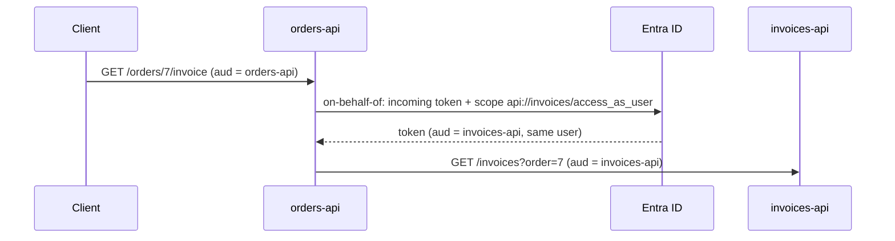

# Calling other services

Your application calls Azure services, and other APIs. Each call needs a token, and each token says
who is calling. This page is about choosing that identity deliberately.



## Order of preference

1. **A managed identity**, for anything running in Azure that calls an Azure service or an API that
   accepts app-only tokens. No credential exists, so none can leak or expire.
2. **A federated credential**, for workloads outside Azure that have an identity of their own: a
   pipeline (workload identity federation), a Kubernetes workload, GitHub Actions.
3. **A certificate** in Key Vault, for what remains: an application outside Azure, or an API that
   must authenticate as its own app registration, such as for the on-behalf-of flow.
4. **A client secret**, only where nothing else is supported.

The app registration script creates certificates and secrets ([Credentials](credentials.md)); a
managed identity comes with the hosting resource.

## Scopes for app-only calls

An application calling as itself asks for `<resource>/.default`: all application permissions
granted to it on that resource. It cannot ask for a single role; what it gets is what was granted.

| Resource          | Scope                                   |
| ----------------- | --------------------------------------- |
| Microsoft Graph   | `https://graph.microsoft.com/.default`  |
| Key Vault         | `https://vault.azure.net/.default`      |
| Azure SQL         | `https://database.windows.net/.default` |
| Your own API      | `api://<appId>/.default`                |

The Azure SDK clients do this for you; pass them a `TokenCredential`.

## One identity, chosen explicitly

`DefaultAzureCredential` tries a list of credentials and takes the first that works: environment
variables, workload identity, managed identity, then the developer's Visual Studio or Azure CLI
sign-in. Convenient on a laptop. In Azure it makes the identity depend on what happens to be
present:

- An `AZURE_CLIENT_ID` variable, set for another purpose, makes it pick a user-assigned identity
  you did not mean.
- With both a system-assigned and a user-assigned identity on the resource, which one is used
  depends on settings nobody remembers making.
- A failing managed identity silently falls through to the next credential in the list, and the
  error you see is about that one.

So let the configuration say which identity to use, and create exactly that credential:

```json
"ManagedIdentity": { "Type": "UserAssigned", "ClientId": "<client-id>" }
```

| Configuration                | Credential                                                         |
| ---------------------------- | ------------------------------------------------------------------ |
| nothing (local development)  | `DefaultAzureCredential` without managed identity, environment and workload identity |
| `SystemAssigned`             | `ManagedIdentityCredential(ManagedIdentityId.SystemAssigned)`       |
| `UserAssigned` + client ID   | `ManagedIdentityCredential(ManagedIdentityId.FromUserAssignedClientId(...))` |

Anything else, such as a client ID without a type, fails at startup. See
[AzureIdentity.cs](../samples/src/Orders.Api/Identity/AzureIdentity.cs). Register one
`TokenCredential` and give it to every Azure SDK client.

Grant the identity Azure RBAC roles on exactly the resources it uses, at the resource, not the
subscription: *Key Vault Secrets User* on its vault, *Storage Blob Data Reader* on its account.

## On behalf of the user

An API that calls another API for a user, such as a back end for a front end, or a gateway, needs
the user's identity downstream. Never forward the incoming token:

- its audience is your API; a downstream API that accepts it does not validate its audience;
- it carries every scope the user consented to for your API, not just what the downstream call needs.

Exchange it instead, with the on-behalf-of flow. Your API authenticates as its own app registration
and gets a token for the downstream API, with the user's identity and the one scope it asks for:



- **One scope per downstream service**, from configuration. A gateway in front of several APIs keeps
  a map from route to scope, and exchanges per call.
- **Consent.** Your API's app registration requests the downstream scope
  (`requiredResourceAccess`), and needs admin consent for it ([Consent](consent.md)). Without it the
  exchange fails with `AADSTS65001`.
- **Credential.** The exchange needs a confidential client: a certificate from Key Vault, or a
  managed identity configured as a federated credential on the app registration, which avoids the
  certificate altogether.
- **Token cache.** MSAL caches exchanged tokens in the confidential client application, keyed by the
  incoming token. Create that client once, not per request. The default cache lives in memory, per
  process: lost on restart, not shared between instances. That is fine for tokens that live an hour;
  use a distributed cache only if the number of token requests becomes a problem.

See [OnBehalfOfHandler.cs](../samples/src/Orders.Api/Downstream/OnBehalfOfHandler.cs), a
`DelegatingHandler` that exchanges the token on every outgoing call, and
[MsalOnBehalfOfTokenSource.cs](../samples/src/Orders.Api/Downstream/MsalOnBehalfOfTokenSource.cs).
The handler refuses to run without a signed-in user: on-behalf-of a background job means nothing.

## Application Insights with Entra ID

By default, telemetry is sent with the instrumentation key in the connection string. Anyone with the
connection string can send telemetry to your resource. With Entra ID authentication, the telemetry
is sent with a token, and the resource can refuse anything else.

1. **Grant the role.** Give the application's identity *Monitoring Metrics Publisher* on the
   Application Insights resource, with Azure RBAC, in the same template that creates the resource.
2. **Tell the SDK.** Set `APPLICATIONINSIGHTS_AUTHENTICATION_STRING` next to the connection string:
   `Authorization=AAD` for the system-assigned identity, `Authorization=AAD;ClientId=<client-id>` for a
   user-assigned one. With OpenTelemetry, pass the matching credential:

   ```csharp
   builder.Services.AddOpenTelemetry().UseAzureMonitor(options => options.Credential = credential);
   ```

   See [Program.cs](../samples/src/Orders.Api/Program.cs): it parses the setting, rejects unknown
   keys and duplicates, and creates the credential like any other.
3. **Migrate.** Keep local authentication enabled on the resource while the applications move over.
   Telemetry with a token and telemetry with the key both arrive. Check per application that its
   telemetry still comes in.
4. **Disable local authentication** (`DisableLocalAuth = true`) once every sender uses a token. From
   then on, telemetry sent with the key is dropped, silently. A sender you forgot stops reporting;
   that is why step 3 checks every one.

Things that bite:

- **Deployment slots.** A staging slot with its own system-assigned identity needs the role too.
  With a user-assigned identity shared by both slots, the swap changes nothing.
- **Local development.** Leave the authentication string empty and send to a resource that still
  allows the key, or sign in as a developer with the role.
- **Other senders.** Availability tests, the Functions host, and agents on virtual machines send
  telemetry too. Each needs a token, or it goes quiet when local authentication is disabled.

## Calling your own API as an application

A worker or another service calling your API without a user gets an app-only token: `api://<appId>/.default`
with a managed identity, or with its app registration's certificate. It needs an app role that allows
applications, assigned in the environment file:

```json
"roleMembers": { "Orders.Process": ["sp:id-orders-processor-dev"] }
```

A managed identity in a group does not get the group's roles in its tokens; the app registration
script assigns it directly. See [Roles and members](roles-and-members.md).
