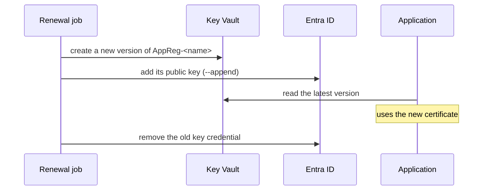

# Credentials

An application that calls another API as itself needs a credential. The script creates one, keeps
it in Key Vault, and never prints it.

Prefer no credential at all: an application running in Azure can use a managed identity, and a
pipeline a federated service connection. Use a credential here for what cannot: an application
outside Azure, a test runner, an API that calls another API on behalf of a user.

## Certificate

```json
"credential": {
  "type": "certificate",
  "keyVault": "kv-orders-#{environment}#",
  "tags": { "owner": "orders-team", "purpose": "Client credential of the orders worker" }
}
```

The certificate is named `AppReg-<displayName>` (characters Key Vault does not allow become
hyphens). On a run:

1. If the vault has no such certificate, it is created with `certificate-policy.json`:
   self-signed, RSA 2048, six months, clientAuth usage. Key Vault creates the private key and never
   lets it out.
2. If it exists, its tags are made to match. Tags added by others are kept.
3. If the application has no credential with that name, the public key is added with
   `az ad app credential reset --append`. `--append` matters: without it, the CLI replaces every
   other credential of the application.

The application reads the certificate from Key Vault at run time with its own identity. It needs
the *Key Vault Secrets User* role: the private key of a Key Vault certificate is read through its
secret.

## Client secret

```json
"credential": {
  "type": "secret",
  "name": "pipeline",
  "keyVault": "kv-orders-#{environment}#",
  "validityInMonths": 6
}
```

If the application has no client secret with that `name`, the script adds one (default validity
12 months) and stores it straight in Key Vault as `AppReg-<displayName>-<name>`, with the same
expiry date. The value passes through a temporary file, never through the command line or the
output.

If storing it fails, the secret is removed from the application again: a secret nobody can read
is useless, and would stop the next run from creating a new one.

A secret's value cannot be read back from Entra ID. If the application has the secret but the vault
copy is gone, the run warns. Delete the client secret on the application and run again to get a
new one.

Prefer a certificate: a secret is a password that can be copied, a certificate's private key stays
in Key Vault.

## Renewal

The script creates credentials; it does not rotate them. Six months is short on purpose: renewal
must be routine, and a forgotten credential is not valid forever.

The pattern that works, for a certificate:



1. **Before expiry**, create a new version of the certificate in Key Vault. Key Vault's policy
   can do this itself (`AutoRenew` at a percentage of the lifetime) or e-mail you to do it
   (`EmailContacts`, the default here).
2. **Add the new public key** to the application, keeping the old one:

   ```powershell
   az ad app credential reset --id <appId> --keyvault <vault> --cert AppReg-<displayName> --append --display-name AppReg-<displayName>
   ```

3. **Let the application pick it up.** It should always read the *latest* version from Key Vault,
   so a restart, or a periodic reload, is enough.
4. **Remove the old key credential** once nothing uses it:

   ```powershell
   az ad app credential list --id <appId> --cert --query "[].{keyId:keyId, end:endDateTime}"
   az ad app credential delete --id <appId> --key-id <old keyId> --cert
   ```

Steps 2 to 4 can run in a scheduled job, or in a background service in the application itself.
Whatever runs them needs to be an owner of the application, with `Application.ReadWrite.OwnedBy`.

For a client secret: add a new secret with a new name, store it, move consumers over, delete the
old one.

## Key Vault roles for the script

| Credential  | Role on the vault                                   |
| ----------- | --------------------------------------------------- |
| certificate | Key Vault Certificates Officer                      |
| secret      | Key Vault Secrets Officer                           |

With access policies instead of Azure RBAC: certificates *get, create, update*; secrets *get, set*.
