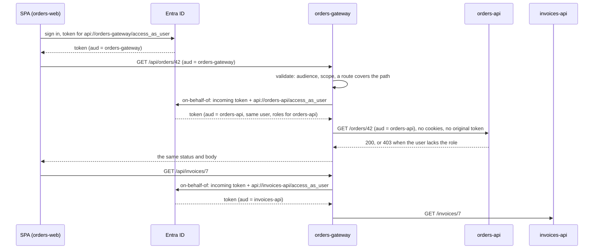

# A gateway for a single-page app, with on-behalf-of

A single-page app (SPA) that calls several APIs needs a token for each of them, CORS on each of
them, and a base URL per environment for each of them. A gateway in front of the APIs reduces that to
one: the SPA calls `/api/...` on its own origin with one token, for the gateway. The gateway
exchanges that token per route, with the on-behalf-of flow, for a token to the API behind the route.
The APIs still see the user, and still decide what the user may do.

This page builds that gateway with [YARP](https://learn.microsoft.com/aspnet/core/fundamentals/servers/yarp/yarp-overview),
Microsoft's reverse proxy library for ASP.NET Core. The code is in
[samples/src/Orders.Gateway](../samples/src/Orders.Gateway/), its app registration is `orders-gateway`
in [app-registrations.json](../app-registrations/app-registrations.json), and its tests run in
memory. The on-behalf-of flow itself is explained in
[Calling other services](calling-other-services.md#on-behalf-of-the-user).

- [When a gateway helps](#when-a-gateway-helps)
- [The flow](#the-flow)
- [The app registrations](#the-app-registrations)
- [Consent in one prompt](#consent-in-one-prompt)
- [Routes and scopes](#routes-and-scopes)
- [The exchange](#the-exchange)
- [One audience, and only the paths you route](#one-audience-and-only-the-paths-you-route)
- [When the user has to act](#when-the-user-has-to-act)
- [Token cache and credential](#token-cache-and-credential)
- [CORS and the SPA](#cors-and-the-spa)
- [Health checks](#health-checks)
- [What not to do](#what-not-to-do)
- [The incident: a probe on an authenticated path](#the-incident-a-probe-on-an-authenticated-path)
- [Troubleshooting](#troubleshooting)
- [Testing it](#testing-it)

## When a gateway helps

A gateway pays off when:

- the SPA calls **more than one API**, or APIs that will move, split or be renamed;
- the SPA and the gateway can share an **origin**, so the browser needs no CORS at all;
- the APIs should **not be reachable from the internet**: only the gateway is, and the APIs accept
  traffic from it alone;
- you want **one place** for cross-cutting concerns at the edge: request size limits, rate limits,
  correlation IDs, logging of who called what.

It is not worth it for a SPA with one API: the SPA can get a token for that API directly, and the
gateway only adds a hop and a token exchange. And it is not a full *back end for front end* in the
cookie sense: the SPA still signs in with MSAL and holds a token, for the gateway only. A gateway
that keeps tokens server-side and gives the browser a session cookie is a different design, with
its own concerns (CSRF, session storage), and not what this page builds.

## The flow



Two things to notice:

- **Authorization stays in the APIs.** The gateway checks that the caller is a signed-in user of
  the SPA; whether that user may read order 42 is for `orders-api` to decide, with the roles in the
  token it receives. Those roles come from the user's assignments on `orders-api`, not on the
  gateway: every API gets its own token, with its own roles.
- **Every call starts with a user.** On-behalf-of exchanges a user's token. Background work that
  calls an API has no user, and uses its own identity instead: see
  [Calling your own API as an application](calling-other-services.md#calling-your-own-api-as-an-application).

## The app registrations

The gateway needs its own app registration. A managed identity cannot be the middle tier: it offers
no scopes for the SPA to ask for, and cannot be the audience of a user's token. So: an application,
with a scope for the SPA and a credential to prove itself in the exchange.

```json
{
  "key": "orders-gateway",
  "displayName": "orders-gateway#{instance}#-#{environment}#",
  "credential": { "type": "certificate", "keyVault": "kv-orders#{instance}#-#{environment}#" },
  "appRoles": [],
  "assignmentRequired": false,
  "scopes": [
    {
      "value": "access_as_user",
      "adminConsentDisplayName": "Use the orders application as the signed-in user",
      "adminConsentDescription": "Lets the orders web application call the orders gateway, and the services behind it, on behalf of the signed-in user."
    }
  ],
  "preAuthorizedApplications": [{ "application": "orders-web", "scopes": ["access_as_user"] }],
  "knownClientApplications": ["orders-web"],
  "requiredResourceAccess": [
    { "resource": "orders-api", "scopes": ["access_as_user"] },
    { "resource": "invoices-api-#{environment}#", "scopes": ["access_as_user"] }
  ]
}
```

| Key                                   | Why                                                                                    |
| ------------------------------------- | -------------------------------------------------------------------------------------- |
| `scopes`: `access_as_user`            | What the SPA asks for. The gateway's policy requires it in `scp`.                      |
| `preAuthorizedApplications`           | The SPA may use that scope without a consent prompt.                                   |
| `knownClientApplications`             | The SPA's consent can also cover what the gateway requests. See the next section.      |
| `requiredResourceAccess`              | One delegated scope per API behind a route: exactly what the exchange will ask for.    |
| `credential`                          | The exchange needs a confidential client. See [Token cache and credential](#token-cache-and-credential). |
| `appRoles: []`                        | The gateway authorizes nothing itself; the APIs do.                                    |
| `assignmentRequired: false`           | With no roles there is nothing to assign; left at the default, nobody gets a token.    |

Two more changes, in the other definitions:

- `orders-api` **pre-authorizes `orders-gateway`** for `access_as_user`, just like it pre-authorizes
  `orders-web`. For an own API, that replaces a consent for the exchange.
- `orders-web` **requests `orders-gateway`'s `access_as_user`**. It keeps its request for
  `orders-api` while screens still call the API directly; remove it once everything goes through the
  gateway.

Who may use the application at all is decided where the user signs in: `orders-web` keeps
*assignment required*, so only users with one of its roles get a token for the SPA, and with it
for the gateway. What they may do is decided by each API: if an API behind the gateway requires
assignment and the user has no role on it, the exchange fails with `AADSTS50105` and the gateway
answers 502. See [Pitfalls](pitfalls.md#assignment-required-locks-people-out).

## Consent in one prompt

The user signs in to the SPA. Without further configuration they consent to what the SPA requests,
and nothing else: the gateway's own permissions on the APIs behind it are never shown to anyone. The
first exchange then fails with `AADSTS65001`.

Three ways out, from least to most user involvement:

1. **Pre-authorize the gateway on own APIs.** `orders-api` lists `orders-gateway` under
   `preAuthorizedApplications`. No consent needed, for anybody. Only possible for APIs you define.
2. **Admin consent for the gateway.** An administrator grants the gateway's requested permissions
   once for the tenant. [Get-ConsentStatus.ps1](consent.md#status-per-permission) lists what is
   missing, under `orders-gateway`, with the admin consent URL. The way to go for another team's
   API, such as `invoices-api` here.
3. **Combined consent.** `knownClientApplications` on the gateway lists the SPA. When the SPA asks
   for the gateway's `.default` scope (`api://<application-id-of-orders-gateway>/.default`), the
   prompt covers the SPA's permissions on the gateway *and* the gateway's permissions on the APIs
   behind it. One prompt, one consent. Only helps where users may consent themselves.

The script manages `knownClientApplications` like the other keys: absent is left alone, `[]` clears
it, and entries are keys, well-known names or application IDs. See
[Configuration](configuration.md#known-client-applications).

## Routes and scopes

YARP reads routes and clusters from configuration. A route matches a path and points at a cluster;
a cluster is a set of destinations, the instances of one API. The scope for the exchange is
**metadata of the cluster**: it belongs to the API, not to the path, so every route to the same API
asks for the same scope.

```json
"ReverseProxy": {
  "Routes": {
    "orders": {
      "ClusterId": "orders-api",
      "Match": { "Path": "/api/orders/{**rest}" },
      "Transforms": [ { "PathRemovePrefix": "/api" } ]
    },
    "invoices": {
      "ClusterId": "invoices-api",
      "Match": { "Path": "/api/invoices/{**rest}" },
      "Transforms": [ { "PathRemovePrefix": "/api" } ]
    }
  },
  "Clusters": {
    "orders-api": {
      "Metadata": { "Scope": "api://<application-id-of-orders-api>/access_as_user" },
      "Destinations": { "primary": { "Address": "https://orders-api-dev.example.com/" } }
    },
    "invoices-api": {
      "Metadata": { "Scope": "api://<application-id-of-invoices-api>/access_as_user" },
      "Destinations": { "primary": { "Address": "https://invoices.example.com/" } }
    }
  }
}
```

The transform provider validates this configuration when YARP loads it, and the gateway does not
start when it is wrong:

| Rule                                                          | Because                                                               |
| ------------------------------------------------------------- | --------------------------------------------------------------------- |
| Every cluster has a `Scope`: an absolute `api://` or `https://` URI with a scope name | No scope means no exchange; a placeholder such as `<application-id-...>` is caught here, not by the first user. |
| Every route starts with a literal path (`/api/orders`), not `/{**catch-all}` | A catch-all sends every path, including ones nobody thought of, to one API with a token for it. |
| No route uses the `Anonymous` authorization policy             | Without a user there is nobody to call on behalf of.                  |

Keep the scopes per environment in configuration, such as Azure App Configuration; the application
IDs differ per environment. A contract test checks that every scope in the routes is one the
gateway's app registration requests: a scope the registration does not request is a consent nobody
was ever asked for.

## The exchange

[OnBehalfOfTransformProvider.cs](../samples/src/Orders.Gateway/Proxy/OnBehalfOfTransformProvider.cs)
adds a request transform to every route. Per request, in this order:

1. **Remove the user's credentials** from the outgoing request: the `Authorization` header and any
   `Cookie`. YARP copies request headers by default; this happens first, so that no failure further
   on can leave the original token in place.
2. **Fail closed.** No scope for the route, or no authenticated user with a saved token: answer
   500 or 401, and do not forward.
3. **Exchange** the incoming token for one with the cluster's scope, and set it as the bearer token.
4. **Map failures** to an answer the SPA can act on; see [When the user has to act](#when-the-user-has-to-act).
   Setting a status code other than 200 in a request transform makes YARP answer directly instead
   of forwarding, which the tests check.

```csharp
builder.Services.AddReverseProxy()
    .LoadFromConfig(builder.Configuration.GetSection("ReverseProxy"))
    .AddTransforms<OnBehalfOfTransformProvider>();
```

The incoming token comes from `HttpContext.GetTokenAsync("access_token")`, which works because the
JWT bearer options set `SaveToken = true`.

### With Microsoft.Identity.Web

The sample uses MSAL directly, like the orders API, which keeps every network call visible and
replaceable in tests. With [Microsoft.Identity.Web](https://learn.microsoft.com/entra/msal/dotnet/microsoft-identity-web/)
the exchange is `ITokenAcquisition.GetAccessTokenForUserAsync([scope], user: httpContext.User)`,
after `.EnableTokenAcquisitionToCallDownstreamApi().AddInMemoryTokenCaches()` on the authentication
setup. Two things to watch:

- **YARP creates transform providers once**, as singletons. `ITokenAcquisition` is scoped: resolve it
  per request from `HttpContext.RequestServices`, never in the provider's constructor. The sample
  resolves its token source the same way, so swapping it is one registration.
- **Consent errors arrive wrapped**: `MicrosoftIdentityWebChallengeUserException`, with the
  `MsalUiRequiredException` inside. Map it like below; the `[AuthorizeForScopes]` attribute that
  handles it in MVC does not apply to a proxied route.

## One audience, and only the paths you route

The SPA's token has the gateway as audience. That is the only audience the gateway accepts:

- **On-behalf-of requires it.** Entra ID only exchanges a token whose audience is the application
  doing the exchange (`AADSTS500131` otherwise).
- **A second audience could only be passed through**, unchanged, to the API it was meant for. That
  is forwarding the user's token, which this gateway exists to avoid. Gateways that accept several
  audiences, each valid on some paths only, are gateways that pass tokens through.

[PathBasedTokenValidator.cs](../samples/src/Orders.Gateway/Security/PathBasedTokenValidator.cs)
runs after the standard token validation and rejects the token unless:

- it has exactly one audience, the gateway's application ID; and
- a configured route covers the request path, at a segment boundary: `/api/orders` covers
  `/api/orders/42`, not `/api/orders-admin`.

A token on a path no route covers gets a 401 and is never exchanged. The check reads the routes from
YARP's own configuration, so it cannot drift from them.

## When the user has to act

The exchange can fail because the user has to do something: consent, multi-factor authentication
demanded by a conditional access policy, or sign in again. MSAL reports that as
`MsalUiRequiredException`. The gateway cannot show a prompt; the SPA can, if the gateway says so.

| What happened                                    | Gateway answers                                    | SPA does                                |
| ------------------------------------------------ | -------------------------------------------------- | --------------------------------------- |
| `MsalUiRequiredException` without claims (consent, expired session) | 401, `WWW-Authenticate: Bearer error="interaction_required", scope="api://<gateway>/.default"` | acquire a token for `scope` interactively |
| `MsalUiRequiredException` with claims (MFA, conditional access) | 401, `error="insufficient_claims", claims="<base64>"` and `scope` | the same, passing the decoded `claims` |
| Any other MSAL error (credential, unknown scope) | 502, logged                                        | show an error; signing in again will not help |
| The API answers 401                              | 502, without the API's `WWW-Authenticate` or body   | show an error                            |
| The API answers 403                              | 403, unchanged                                     | show "not allowed"                      |
| No token, wrong audience, missing scope          | 401 or 403 from the gateway itself                 | sign in (401) or show "not allowed" (403) |

The 502 for a 401 from the API is deliberate. A 401 there means the API does not accept the token
the gateway obtained: a configuration problem between the two (wrong scope, wrong audience in the
API, a clock). Passed on, the SPA reads it as "your token is bad", signs the user in again, gets the
same 401, and loops.

## Token cache and credential

**Cache.** MSAL caches exchanged tokens in the confidential client application, keyed by the
incoming token and the scope. The token source is a singleton that builds that client once, so a
user calling the same API ten times in an hour costs one exchange. A client per request throws the
cache away and asks Entra ID on every call, until it throttles. The cache is in memory, per instance;
behind several instances each has its own, which costs one exchange per instance, user and API. Move
to a distributed cache only if that number becomes a problem.

**Credential.** The exchange authenticates the gateway as its app registration. Options, best first:

- **A managed identity as federated credential.** Add the gateway's managed identity as a federated
  identity credential on the app registration, and build the client with
  `.WithClientAssertion(...)`, getting the assertion from the managed identity for
  `api://AzureADTokenExchange/.default`. No secret or certificate exists at all. The script in this
  repository does not manage federated credentials; add them in your infrastructure code.
- **A certificate in Key Vault**, as in the sample: the script creates it, the gateway reads it with
  its managed identity (*Key Vault Secrets User*) and sends it with `sendX5C: true`. See
  [Credentials](credentials.md).
- A client secret: works, expires, and leaks more easily. Avoid it for a gateway.

## CORS and the SPA

**Same origin first.** Serve the SPA and the gateway from one origin, for instance with the SPA's
static files behind the same front door, or a front door that routes `/api/*` to the gateway and
everything else to the SPA. The browser then sends no preflight, and the gateway needs no CORS
configuration: `Cors:AllowedOrigins` stays empty.

During development the SPA runs on its own dev server. Let that server proxy `/api` to the gateway
(Vite: `server.proxy`), and the browser still sees one origin. Only when that is impossible, list the
SPA's origin:

```json
"Cors": { "AllowedOrigins": ["http://localhost:5173"] }
```

The gateway refuses to start with `*`, a wildcard or a path in an origin. It allows the methods and
the `Authorization` and `Content-Type` headers the SPA uses, exposes `WWW-Authenticate` (without it,
script on another origin cannot read the consent challenge), and does not allow credentials: the
SPA sends a bearer token, not cookies. `UseCors()` comes before authentication, so that a preflight,
which carries no token, is answered and not challenged.

**The SPA.** One scope, for the gateway, and relative URLs:

```typescript
const gatewayScope = "api://<application-id-of-orders-gateway>/access_as_user";

async function callGateway(path: string): Promise<Response> {
  const account = msal.getActiveAccount()!;
  const { accessToken } = await msal.acquireTokenSilent({ scopes: [gatewayScope], account });
  const response = await fetch(`/api${path}`, { headers: { Authorization: `Bearer ${accessToken}` } });

  const challenge = response.headers.get("WWW-Authenticate") ?? "";
  if (response.status === 401 && /error="(interaction_required|insufficient_claims)"/.test(challenge)) {
    const scope = /scope="([^"]+)"/.exec(challenge)?.[1] ?? gatewayScope;
    const claims = /claims="([^"]+)"/.exec(challenge)?.[1];
    await msal.acquireTokenRedirect({ scopes: [scope], claims: claims ? atob(claims) : undefined });
  }

  return response;
}
```

React only to a 401 that carries one of these two errors. Any other 401 or a 502 is not something a
new sign-in fixes.

## Health checks

The gateway maps `/health` with `AllowAnonymous()`, next to a fallback policy that requires a user
everywhere else. The health check reports whether the process is up; it calls no API behind the
gateway, because that would need a user's token, and because a slow downstream API should not take
the gateway out of rotation. A test asserts that `/health` answers 200 without a token.

Point every probe at it: the load balancer's, the platform's (App Service health check, container
liveness probe), and your availability tests. Never at `/`, and never at a proxied path.

## What not to do

- **Forward the user's token.** The APIs would have to accept a token for the gateway, which means
  they no longer validate the audience. Exchange per route, and remove the original `Authorization`
  header and cookies before anything else.
- **Accept more audiences "for now".** A second audience can only be passed through. See
  [One audience](#one-audience-and-only-the-paths-you-route).
- **Use a catch-all route.** `/{**catch-all}` to one API sends whatever the browser asks for to it,
  with a token. Route the paths you mean.
- **Put authentication on the health endpoint**, or a probe on an authenticated path. See the
  incident below.
- **Create a confidential client per request.** The token cache goes with it.
- **Turn every failure into a 401.** The SPA cannot tell "sign in again" from "the gateway is
  misconfigured", and loops.
- **Allow any origin.** `AllowAnyOrigin` with bearer tokens invites every site to call your gateway
  with whatever token it can get. List origins, or better, need none.
- **Authorize in the gateway with roles of the gateway.** The roles that matter are on each API, and
  arrive in the exchanged token. A second role model on the gateway drifts from them.

## The incident: a probe on an authenticated path

A generalised account of an outage behind a gateway like this one.

**What happened.** A change to the gateway's authentication made it stricter: requests that were
not explicitly allowed now required a token. Among them was the root path `/`, which used to answer
200 and now answered 401. The load balancer in front of the gateway probed exactly that path. After
a few minutes of failed probes it marked every instance unhealthy and stopped sending traffic, and
every user got a 502 from the load balancer. The SPA could no longer reach any API.

**Why it was not caught.** The tests after deployment called the gateway from inside the network,
past the load balancer, and passed. The probe needed about four minutes of consecutive failures
before it acted, longer than the tests took, so the pipeline was green before the outage started.
Nothing alerted on backend health.

**Mitigation.** The probe was changed to accept 401 as healthy, which restored traffic, until the
gateway had a proper health endpoint; then the probe was pointed there and the exception removed.

**Lessons.**

1. **A dedicated, anonymous health endpoint** is the only probe target, with a test that it stays
   anonymous when the authentication setup changes.
2. **Never probe an authenticated or proxied path.** A probe that depends on authentication turns
   every auth change into a possible outage.
3. **Test through the front door.** At least one smoke test after deployment goes through the
   public entry point, as a browser would, including one that loads the SPA and makes an API call.
4. **Probe thresholds shorter than the deployment tests**, or a deliberate wait, so that an unhealthy
   backend shows up while the pipeline still runs.
5. **Alert on backend health** of the load balancer, not only on errors in the application, which
   saw no requests at all.
6. **A fast way back**: a rollback of the gateway that does not wait for a full release.

## Troubleshooting

| Error                    | Where                       | Usually means                                                                 |
| ------------------------ | --------------------------- | ----------------------------------------------------------------------------- |
| `AADSTS65001`            | exchange                    | No consent for the gateway's permission on the API. Pre-authorize the gateway, grant admin consent, or use combined consent. |
| `AADSTS500131`           | exchange                    | The incoming token's audience is not the gateway: the SPA asked for a token for another API. |
| `AADSTS50013`            | exchange                    | The incoming token cannot be used as an assertion: expired, or not issued by this tenant. |
| `AADSTS50076`, `AADSTS50079` | exchange (as `MsalUiRequiredException` with claims) | Conditional access wants MFA for the API behind the route; the SPA must pass the claims. |
| `AADSTS50105`            | sign-in or exchange         | The API (or the gateway) requires assignment and the user has no role on it.   |
| `AADSTS70011`            | exchange                    | The scope is malformed or not offered by the API: check the cluster's `Scope`. |
| `AADSTS500011`           | exchange                    | The API in the scope does not exist in this tenant: wrong application ID for the environment. |
| `AADSTS90009`            | exchange                    | The gateway asked for a token for itself: a cluster's `Scope` points at the gateway. |
| `AADSTS700016`           | exchange                    | The gateway's `EntraId:ClientId` is not an application in this tenant.        |
| `AADSTS700027`           | exchange                    | The certificate the gateway sends is not (or no longer) on its app registration. |
| `AADSTS7000215`          | exchange                    | Wrong or expired client secret.                                               |
| 502 after deployment, gateway logs quiet | load balancer | The probe marks the gateway unhealthy. Check what path it probes.         |
| 502 with "rejected the on-behalf-of token" in the logs | API | The API does not accept the exchanged token: its audience or issuer settings. |
| SPA keeps redirecting to sign-in | SPA                 | It treats every 401 as "sign in again". React only to the challenge errors.   |
| Preflight fails          | browser                     | The origin is not listed, or `UseCors()` comes after authentication.          |

The MSAL exception's `ErrorCode` and the `AADSTS` number in its message are logged by the gateway
for every failed exchange. The incoming token is never logged.

## Testing it

[Orders.Gateway.Tests](../samples/tests/Orders.Gateway.Tests/) runs the real gateway in memory, with
its real authentication, routes and transforms. Only the edges are fakes: the signing key, the token
exchange, and the network to the APIs (an `IForwarderHttpClientFactory` that records what YARP sends).

| Test                                                  | Proves                                                   |
| ----------------------------------------------------- | -------------------------------------------------------- |
| `Each_route_gets_a_token_for_the_scope_of_its_api`     | route metadata decides the scope, and the path is rewritten |
| `The_users_own_token_and_cookies_never_reach_the_api`  | nothing of the user's own credentials is forwarded       |
| `A_path_no_route_covers_fails_closed`                  | no exchange, no forward, for a path no route claims       |
| `A_token_for_another_audience_is_rejected_not_passed_on` | one audience                                          |
| `Consent_or_sign_in_needed_becomes_a_challenge_the_spa_can_act_on` | the 401 and its `WWW-Authenticate`             |
| `A_401_from_the_api_becomes_a_bad_gateway_so_the_spa_does_not_loop`, `A_403_from_the_api_reaches_the_spa_unchanged` | the response mapping |
| `The_health_endpoint_answers_without_a_token`          | the probe target stays anonymous                         |
| `ConfigurationTests`                                   | catch-all routes, anonymous routes, clusters without a scope and wildcard origins stop the gateway |
| `DefinitionContractTests`                              | the routes ask only for scopes the app registration requests |

The pattern is the same as in [Testing authorization](testing-authorization.md): issue tokens in the
test, replace the metadata endpoint with a static configuration, and assert on what crosses the
boundary.
