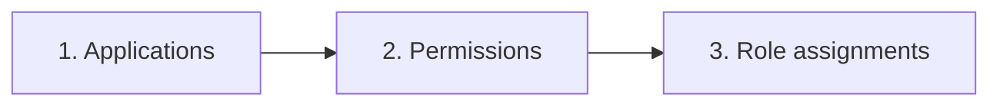

# How it works

One run makes Entra ID match the configuration of one environment. It reads, compares and only
writes what differs, so running it twice changes nothing the second time.

## Two files make one configuration

```text
app-registrations.json  +  environments/test.json  =  configuration of 'test'
  what each application is   who, where, which names
```

The definitions use tokens such as `#{environment}#`. The environment file fills them in under
`tokens`; a token without a value stops the run before anything happens. The definition as written,
with its tokens, is kept as well: the consent comparison uses it to line up the same permission in
two environments whose names differ.

## Three phases

A run goes through all applications three times. Each phase needs what the previous one created.



### 1. Applications

Per application, in the order of the definition file:

1. Find it by display name, or create it (single tenant, v2 access tokens).
2. Set the identifier URI `api://<appId>`.
3. Make the app roles match, then the scopes.
4. Set the redirect URIs of the environment.
5. Make sure the credential exists: a certificate or a client secret, in Key Vault.
6. Find or create the service principal (the "enterprise application"), and set
   *assignment required*.
7. Make the owners of application and service principal match.

After this phase every application exists, with the IDs of its roles and scopes.

### 2. Permissions

Now references between applications can be resolved, whichever order they were defined in:

- **Requested permissions** (`requiredResourceAccess`). A resource is named by the key of an own
  application, a well-known name (`microsoft-graph`), an application ID, or the display name of
  another team's API. Permissions are named by value (`User.Read`) and written as IDs.
- **Pre-authorized clients** of an own API: clients that may use its scopes without a consent
  prompt.

### 3. Role assignments

Per role, the desired members are:

- the members listed in the environment file, and
- the own applications that request the role as an application permission.

Members that are not assigned get assigned; assignments that are not desired are removed. The
environment file is the source of truth. See [Roles and members](roles-and-members.md).

## Changing roles and scopes safely

Entra ID refuses to change or delete an enabled role or scope. The script therefore disables the
affected ones first, then writes the new list. It keeps the ID of a role or scope that only changed
its description: assignments and consent are tied to the ID and survive.

A scope that is still pre-authorized cannot be removed either; the script takes it off the
pre-authorized clients in the same step.

## Only what is defined is managed

A key that is absent is left alone. A definition without `appRoles` does not remove roles added in
the portal; one with `"appRoles": []` removes them all. The same holds for `scopes`,
`requiredResourceAccess`, `preAuthorizedApplications` and each redirect URI platform.

The script never deletes an application or service principal. Removing a definition stops managing
that application; deleting it is a deliberate, manual step.

## The dry run

`-WhatIf` runs the same code with every write replaced by a log line. Every change goes through one
function that either records and performs it, or only records it. That is why a plan lists exactly
the changes the real run then makes, and why the tests can prove it.

Two things a dry run cannot know: the IDs of applications it would create (shown as `new:<key>`),
and anything that depends on those, such as the role IDs of a new API.

## Identity is the display name

An application is found by its display name. Rename it in the definition and the next run creates
a new application. Two applications with the same name stop the run: assigning access must not be
a guess. See [Pitfalls](pitfalls.md#renaming-creates-a-new-application).

## Errors stop the run

Before anything is written, the configuration is validated offline and the owners are resolved.
During the run, a name that cannot be resolved, a resource that does not exist, or a user listed in
a role that only allows applications stops the run on the spot, before that role's assignments are
touched. A missing name would otherwise look like "nobody should have this role", and remove
everyone's access. Fix the cause and run again: whatever was already applied is simply found in
place.

`-AllowUnresolvedPrincipals` turns unresolved names into warnings. Use it knowingly.

## Where it talks to Azure

All calls go through two functions in [lib/Graph.ps1](../app-registrations/lib/Graph.ps1):
`Invoke-Graph` (Microsoft Graph via `az rest`) and `Invoke-AzCli` (Key Vault and credentials). The
tests replace those two with an in-memory directory that enforces the same rules Entra ID does,
such as "disable before you change". See [the tests](../app-registrations/tests/Sync.Tests.ps1).
